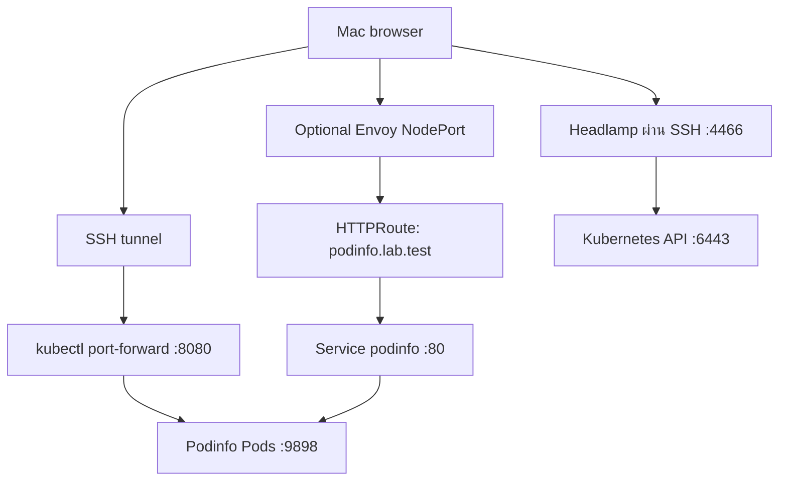

# 00 — โครงสร้างและพอร์ต

> ฉบับ public: IP `192.0.2.10`, hostname `lab-control-plane` และ user `labadmin` เป็นค่าตัวอย่าง ไม่ใช่ข้อมูลเครื่องจริง ต้องแทนด้วยค่าของคุณก่อนรันคำสั่ง (192.0.2.0/24 เป็น TEST-NET สำหรับเอกสาร)

| รายการ | ค่าในแล็บ |
|---|---|
| Node | lab-control-plane / 192.0.2.10 |
| LAN | 192.0.2.0/24 |
| Pod CIDR | 10.244.0.0/16 |
| Service CIDR | 10.96.0.0/12 |
| Podinfo container port | 9898 |
| Podinfo Service port | 80 |
| Server port-forward | localhost:8080 |
| Mac tunnel สำหรับ Podinfo | localhost:9090 → Server localhost:8080 |
| Headlamp | localhost:4466 ผ่าน SSH |
| Gateway | NodePort จัดสรรโดย Kubernetes; ตรวจจริงก่อนใช้ |

Pod CIDR / Service CIDR ต้องไม่ทับ LAN, VPN หรือ bridge network
เครื่องนี้มีหลาย interfaces: kubeadm ระบุ node-ip และ Calico เลือก Kubernetes InternalIP ชัดเจน
จอง IP บน Router/DHCP หรือ Static IP; อย่าเปลี่ยน IP ของ Control Plane โดยแก้ kubeconfig อย่างเดียว

คำว่า gateway มี 2 ความหมาย:
1. **Default gateway ของ Linux**: Router ออก Internet ดูด้วย `ip route show default`; ไม่เดาค่าและไม่แก้ route เพื่อทำบทเรียนนี้
2. **Application Gateway**: รับ HTTP/HTTPS แล้วส่งให้ Service ใช้ Envoy Gateway ในบท 06

Gateway ไม่ใช่สิ่งจำเป็นสำหรับ pod-to-pod traffic หรือ port-forward
single-node ไม่ใช้ drain เพื่อทดสอบย้ายแอป เพราะไม่มี Node ปลายทาง
